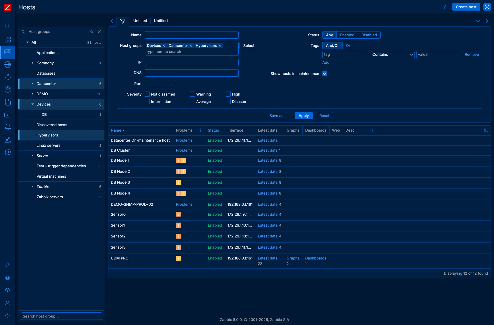
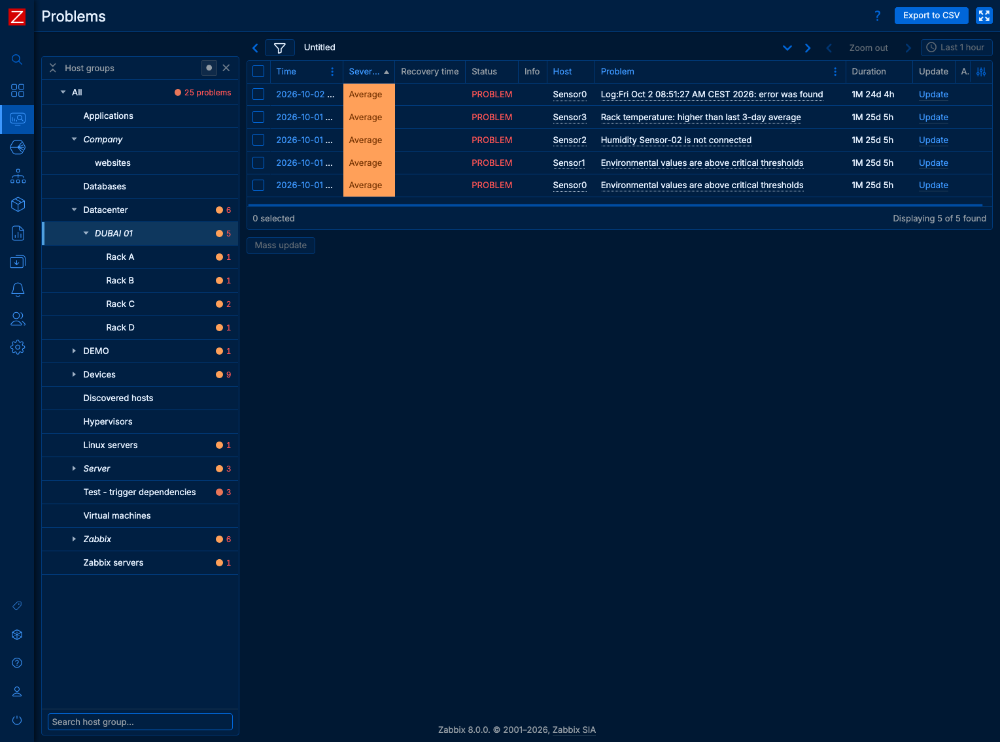
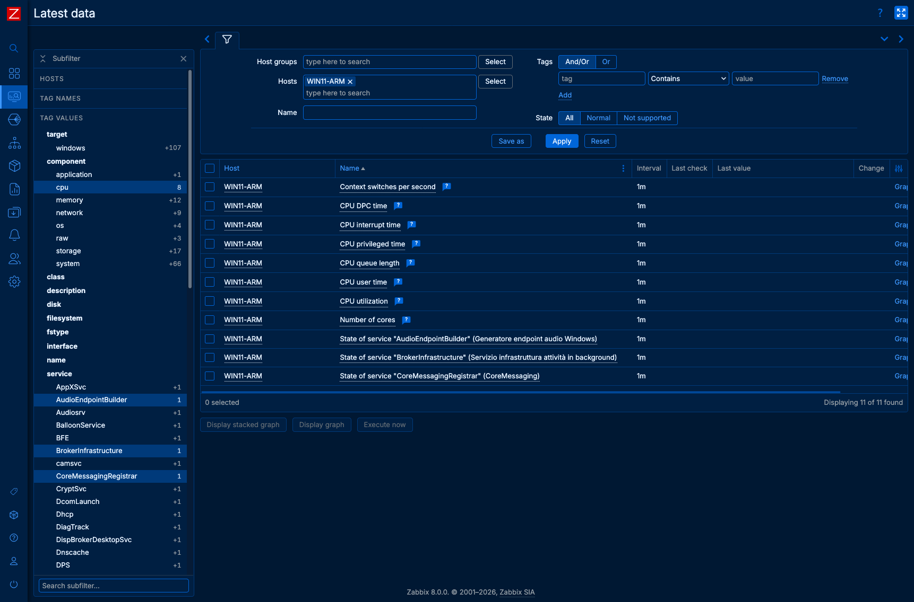
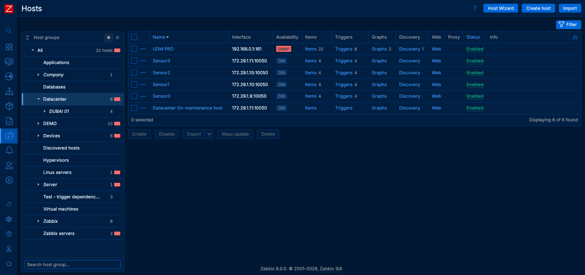
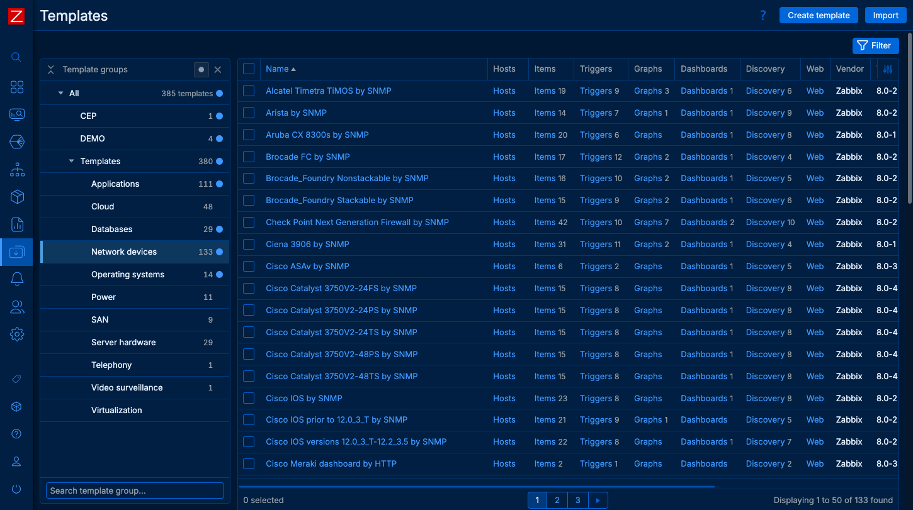
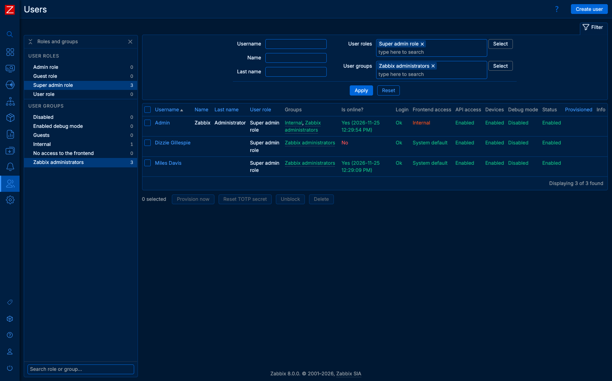
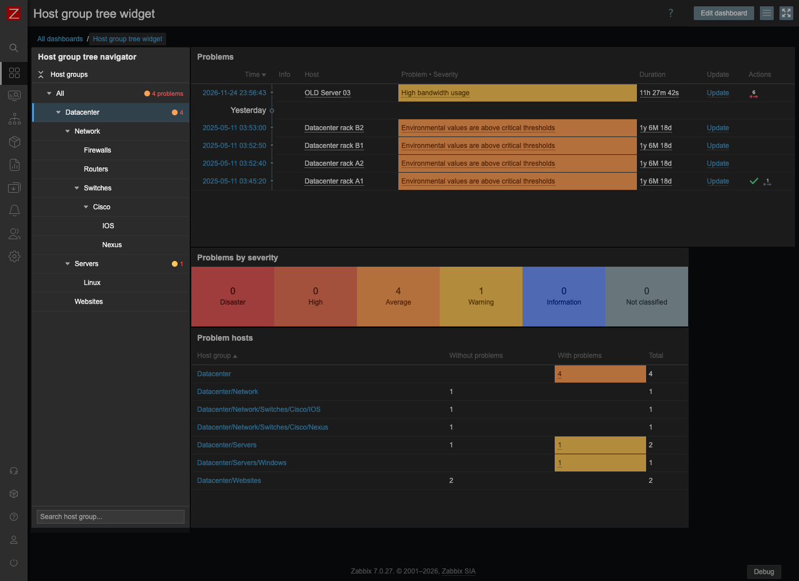
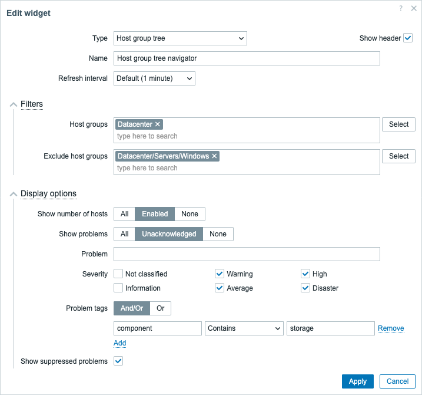
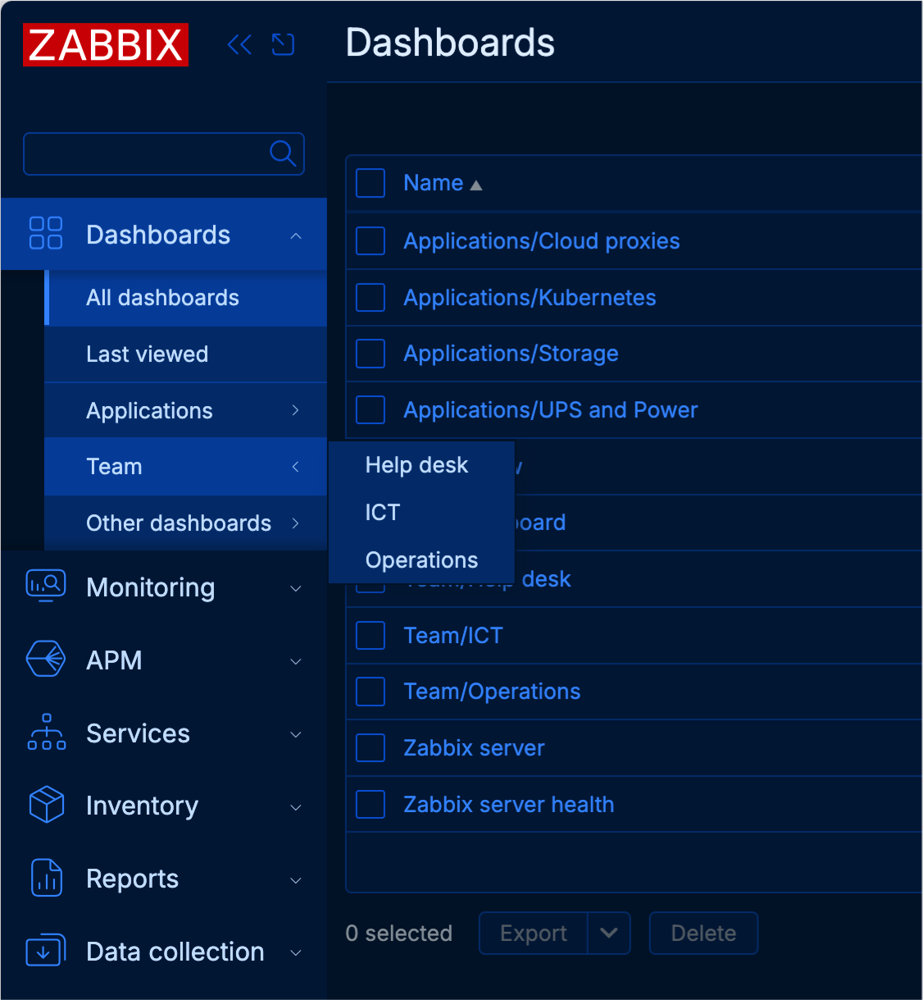

# Smart navigation panels for Zabbix (7.0 / 8.0)

*Formerly **Host group tree** (repository `zabbix-module-hostgroups-tree`, renamed in 1.25.0).*

Navigation panels next to the native lists of the Zabbix frontend, a dashboard widget and a dashboard menu, in
three modules:

- **Smart navigation panels**: a panel next to the list of **Monitoring › Hosts**, **Monitoring › Problems** and
  **Data collection › Hosts** (host group tree), **Data collection › Templates** (template group tree),
  **Monitoring › Latest data** (subfilter, see [Latest data subfilter](#latest-data-subfilter)) and **Users › Users**
  (roles and groups, see [Users subfilter](#users-subfilter)). The native page (tab filters, list, sorting, paging, auto-refresh, 8.0 table
  customizations) is **neither replaced nor copied**: the module wraps it in a two-column layout and drives the
  native filter.
- **Smart navigation widget**: the *Host group tree* dashboard navigation widget (see [Dashboard widget](#dashboard-widget)).
- **Smart navigation dashboard menu**: the *Dashboards* item of the main menu as a submenu, with the dashboards
  grouped by the prefix of their name (see [Dashboard menu](#dashboard-menu)).

The same release works on Zabbix 7.0 and 8.0 (see [Zabbix 7.0](#zabbix-70)).

## How to use

### Monitoring › Hosts



- Click a host group: the list shows its hosts (subgroups included); the group also opens.
- Ctrl/⌘ + click: several groups at once; *All* removes the group filter.
- Number of hosts per group; dot button: worst problem severity per group (click the dot → Problems).
- `⋯` or right click on a row: Problems, Latest data, Inventory, configuration, maintenance.

### Monitoring › Problems



- Click a host group: the problems of its hosts; Ctrl/⌘ + click for several groups.
- Number of problems and worst severity per group, counted with the applied filter.
- Dot button: show / hide the severity dots.

### Monitoring › Latest data



- The subfilter of the page, vertically, in collapsible sections (the native one is hidden).
- Click a value: only that value of its list; Ctrl/⌘ + click for several values.
- Tag values: one accordion per tag, `target`, `component`, `application` first.
- Search box: filters values and tags.

### Data collection › Hosts



- Click a host group: the list shows its hosts; the other filter fields are kept.
- Number of hosts per group, counted with the applied filter.
- Dot button: red mark on groups with unavailable hosts.

### Data collection › Templates



- Click a template group: the list shows its templates; the other filter fields are kept.
- Number of templates per group, counted with the applied filter.
- Dot button: blue dot on groups with templates linked to hosts (number in the tooltip).

### Users › Users



- *User roles* and *User groups* with the number of users.
- Click a value: only that role / group in the filter; Ctrl/⌘ + click for several.
- Values with no users (with the rest of the filter) are not clickable.

### Dashboard widget





- Add the *Host group tree* widget and select it as the *Host groups* source of the other widgets.
- Click a group: the other widgets show its data; Ctrl/⌘ + click for several groups.
- The selection is kept when moving between the pages of the dashboard.
- Settings: root and excluded groups, number of hosts, problems (name, severity, tags).

### Dashboard menu



- Name the dashboards `Menu/Dashboard`: *Dashboards* in the main menu shows a submenu per `Menu`.
- *All dashboards* and *Last viewed* first, the dashboards without `/` under *Other dashboards* at the end.
- Only the dashboards you can see, menus and dashboards in the order of the *All dashboards* list.
- The current dashboard and its menu are highlighted.

## What's new

| Version | Changes |
|---|---|
| 1.26.0 | New module **Smart navigation dashboard menu** (`dashboard-menu/`): *Dashboards* in the main menu becomes a submenu, dashboards named `Menu/Dashboard` grouped by menu, plus *All dashboards*, *Last viewed* and *Other dashboards* (see [Dashboard menu](#dashboard-menu)). |
| 1.25.0 | Renamed **Smart navigation panels for Zabbix**: modules *Smart navigation panels* and *Smart navigation widget* (the widget type is still *Host group tree*). Only the display names change: module ids, folders and settings are the same, nothing to do after the upgrade. |
| 1.24.1 | Dot button: filled = on, empty = off, tooltip and default per page (Problems on, Hosts off, Data collection › Hosts on, Templates off). Hover tooltips: full name only when cut, Ctrl/Cmd hint on the other rows while one is selected. |
| 1.24.0 | Trees (panel and widget): a click on a name also opens the group; a second click on the selected group closes it. Latest data and Users: a click selects only that value of its list, Ctrl/⌘ + click for multiple selection. Users: values with no users are only not clickable (no grey). Dot button highlighted when on. |
| 1.23.0 | Data collection › Templates: header dot button showing a blue dot on the groups with templates in use (linked directly to hosts), with their number in the tooltip. |
| 1.22.0 | **Data collection › Templates**: template group tree with the number of templates (counted with the applied filter). **Users › Users**: user roles and user groups as an accordion, like the Latest data subfilter (see [Users subfilter](#users-subfilter)). `config.json`: `pages.data_collection_templates`, `pages.users_users`. |
| 1.21.1 | Cleanup for performance and robustness: no problem query on Data collection › Hosts; widget API calls limited to the groups of the tree when it is filtered (none when hosts and problems are hidden); an older tree refresh can no longer overwrite a newer one, refreshes do not overlap and run again when the browser tab comes back; less storage and layout work; dead code removed. |
| 1.21.0 | Panel and widget rows have a fixed height of 33px. New header button (Hosts, Problems, Data collection › Hosts) to hide / show the status dots, remembered per page. |
| 1.20.3 | Panel: no change of row height / border colors a moment after the page loads (native style cached per page and theme, copied again when the list changes). |
| 1.20.2 | Panel rows as tall as the rows of the page list; widget rows as tall as a standard Zabbix list row. |
| 1.20.1 | Widget: *Filters* has only the host groups; the problem settings are in *Display options*. |
| 1.20.0 | Widget: *Problem* and *Problem tags* filters; settings reordered as in the *Problems* widget. Panel: on Latest data the hidden panel says *Show subfilter*. |
| 1.19.5 | Latest data subfilter: the number of selected values is shown only on closed sections / tags. |
| 1.19.3 | Latest data subfilter: the whole row of a value is clickable, a selected value colors the whole row (native selected color), counts right-aligned, no tooltips on values, selected counts as plain italic text, e.g. *(2)*. |
| 1.19.2 | Latest data subfilter with the native look: section titles as the native ones, values as native subfilter links (selected = native badge), tag names in bold, no arrows, borders only between sections. Priority tags: `target`, `component`, `application` (case-insensitive), open by default. |
| 1.19.1 | Latest data subfilter as an accordion (no tree arrows): only *Tag values* open at first; *Tags* renamed *Tag names*; inside *Tag values* the tags `target` and `component` first and open (`subfilter_priority_tags`); tag names shown as chips, values indented. |
| 1.19.0 | **Monitoring › Latest data**: the subfilter in the panel, vertically, with collapsible sections and one accordion per tag for the tag values; the native subfilter is hidden while the panel is shown (see [Latest data subfilter](#latest-data-subfilter)). `config.json`: `pages.monitoring_latest`. |
| 1.18.5 | Zabbix 8.0 dark themes (*Dark blue*, *Dark classic*): the panel takes the colors of the 8.0 lists (div-based datatables) instead of a white background. Monitoring › Hosts: the number of hosts with problems is shown only in the tooltip of the dot again. |
| 1.18.4 | Widget: *Show number of hosts* is *All* / *Enabled* / *None* (default *None*). |
| 1.18.3 | Units of the *All* row in lowercase (panel and widget). |
| 1.18.2 | One release for Zabbix 7.0 and 8.0. Repository layout: the two modules are sibling folders named as their install folders; release zips in `dist/` (`tools/package.sh`). |
| 1.18 | **Dashboard widget** *Host group tree (widget)*: the same tree as a navigation widget, broadcasts the selected host groups to the other widgets and keeps the selection across dashboard pages (see [Dashboard widget](#dashboard-widget)). Panel: the expand/collapse all button is on the left edge of the header. Module names: *Host group tree (panel)* and *Host group tree (widget)*. |
| 1.17 | `config.json`: `pages` enables the tree page by page; comments allowed and every option described. Expand/collapse all is one button, shown by default (*Collapse all* while a group is expanded, otherwise *Expand all*); Alt + click on an arrow and `*` expand/collapse a whole branch. |
| 1.16 | The *All* row shows the unit after the total. |

## Installation

1. Copy the module folders to `<Zabbix frontend>/modules/` (e.g. `/usr/share/zabbix/modules/`), with the same
   owner/permissions as the other frontend files:
   - `hostgrouptree/` → the panel;
   - `hostgrouptree-widget/` → the dashboard widget;
   - `dashboard-menu/` → the dashboard menu.

   Install any of them: they do not depend on each other. `hostgrouptree-all-<version>.zip` contains all the
   folders and can be extracted directly into `modules/`.

   **Quick install** with git (the clone itself has no manifest and is ignored by Zabbix; the links are the modules):

   ```bash
   cd /usr/share/zabbix/ui/modules   # or /usr/share/zabbix/modules on some platforms / versions
   git clone https://github.com/bitmind/zabbix-smart-navigation
   ln -s zabbix-smart-navigation/hostgrouptree        zabbix-smart-navigation-module
   ln -s zabbix-smart-navigation/hostgrouptree-widget zabbix-smart-navigation-widget
   ln -s zabbix-smart-navigation/dashboard-menu       zabbix-smart-navigation-dashboard-menu
   ```

   Upgrade with `git -C zabbix-smart-navigation pull`. If you edit `config.json`, first run
   `git -C zabbix-smart-navigation update-index --skip-worktree hostgrouptree/config.json`, so that `git pull`
   keeps it. Zabbix registers modules by folder: switching an existing installation between the copied folders and
   the links means scanning the directory and enabling the modules again (dashboard widgets are kept).
2. *Administration › General › Modules* → **Scan directory** → enable **Smart navigation panels**,
   **Smart navigation widget** and/or **Smart navigation dashboard menu**.
3. Reload the page (Ctrl+F5 the first time, so that no cached assets are used).

Separate modules because Zabbix loads widgets only from modules of type `widget`, and loads the assets of those
modules only on dashboards: the panel, which runs on other pages, needs a module of its own; the dashboard menu is
independent of both.

To upgrade, replace the folders and keep your `hostgrouptree/config.json`. To uninstall: disable the modules. The
state saved in the browser (`localStorage` / `sessionStorage` keys starting with `hostgrouptree.`) is harmless.

## Zabbix 7.0

Same code as on 8.0; differences are detected at runtime. Expected differences on 7.0:

- the host group form is a page, not a popup: *Edit host group* and *Add group* open
  *Data collection › Host groups › form*;
- 7.0 tables have no rounded corners: the panel copies the style of the host table, so it has square corners and the
  same border as the list;
- no table customizations (introduced in 8.0).

## Structure

```
hostgrouptree/                       panel module -> <frontend>/modules/hostgrouptree
├── manifest.json                    JSON action + assets loaded by the frontend
├── config.json                      module configuration (see "Configuration")
├── Module.php
├── actions/HostGroupTreeData.php    zabbix.php?action=hostgrouptree.data → tree JSON
└── assets/
    ├── js/hostgrouptree.js          layout, tree, synchronization with the filter
    └── css/hostgrouptree.css

hostgrouptree-widget/                widget module -> <frontend>/modules/hostgrouptree-widget
├── manifest.json                    type "widget", broadcasts _hostgroupid / _hostgroupids
├── Widget.php
├── includes/WidgetForm.php          widget settings
├── actions/WidgetView.php           tree + counters as JSON variables
├── views/widget.edit.php, views/widget.view.php
└── assets/
    ├── js/class.widget.js           CWidgetHostGroupTree
    └── css/widget.css

dashboard-menu/                      dashboard menu module -> <frontend>/modules/dashboard-menu
├── manifest.json
└── Module.php                       builds the Dashboards submenu (server side, no assets)

tests/                               PHP tests and mock pages (no Zabbix needed)
tools/package.sh [ref]               release zips in dist/
tools/deploy.sh <modules dir> [ref]  copies the modules into a modules/ folder (keeps config.json)
```

Module assets are loaded on every page: the script exits immediately unless the page is one of those it handles
(Monitoring › Hosts, Monitoring › Problems, Data collection › Hosts, plus the maintenance list and form and the host
group list and form, for the automatic form filling), and does nothing in kiosk mode.

## Pages

| Page | Columns / indicators per group | Menu › MONITORING |
|---|---|---|
| Monitoring › Hosts | *Host groups* · *Hosts* (number of hosts, right-aligned) · *Problems* (dot with the worst severity; its tooltip shows the hosts with problems) | Problems, Latest data, Inventory |
| Monitoring › Problems | *Host groups* · *Problems* (dot with the worst severity + number of problems in red, the same red as the *PROBLEM* status; empty if 0) | Hosts, Latest data, Inventory |
| Monitoring › Latest data | Not a tree: the native subfilter, vertically (see [Latest data subfilter](#latest-data-subfilter)) | — |
| Data collection › Templates | *Template groups* · *Templates* (number of templates of the subtree, counted with the applied filter) · *In use* (blue dot, hidden at first: the subtree has templates linked directly to hosts; the tooltip shows how many); no menu | — |
| Users › Users | Not a tree: *User roles* and *User groups* as an accordion (see [Users subfilter](#users-subfilter)) | — |
| Data collection › Hosts | *Host groups* · *Hosts* · *Availability* (small rounded red rectangle, like the availability icons, if the group has hosts with unavailable interfaces); counts computed with the applied filter | Hosts, Problems, Latest data, Inventory (CONFIGURATION without *Hosts*) |

**Monitoring › Hosts:** the problems counted are the active, non-suppressed ones, limited to the severities checked in
the *Severity* filter of the active tab.

**Monitoring › Problems:** the counters apply **all the fields of the applied filter** of the active tab (Show
Recent/Problems/History with the time selector period, hosts, triggers, name, severities, age, inventory, tags,
suppressed, acknowledgement, symptoms…) **except Host groups**, which is exactly what the tree counts per group. The
JS sends the page query to the endpoint (`problem_filter`) and the endpoint uses the same function as the native list,
`CScreenProblem::getData()`. If it is not available in a version, it falls back to `problem.get` with the main fields
(severities, hosts, triggers, name, tags, suppressed, acknowledgement, symptoms, age; *History* is treated as
*Problems*). The counters are reloaded when a different filter is applied; selecting a group does not reload them.
At most `problem_limit` problems are read (default 50,000).

**Data collection › Hosts:** the number of hosts and the red indicator take into account the applied filter of the
page (name, DNS, IP, port, status, monitored by / proxy / proxy group, templates, tags), except *Host groups*. If an
option is not supported by the version, the endpoint counts without the filter instead of failing. The red indicator
uses the logic of the *Host availability* widget with its default settings: monitored hosts not in maintenance; Agent,
SNMP, IPMI, JMX interfaces and active agent checks; "not available" = `INTERFACE_AVAILABLE_FALSE`. The tooltip shows
how many hosts are affected. The filter of this page is the classic filter (not a tab filter): clicking a group
resubmits the filter form with all its current fields, replacing only *Host groups* and going back to the first page.

**Data collection › Templates:** the same tree with the template groups. The number of templates takes into account
the applied filter of the page (name, vendor, version, linked templates, tags) except *Template groups*, and counts
only the templates the user can edit, as the list does. Clicking a group resubmits the classic filter of the page
with only *Template groups* replaced, like Data collection › Hosts. The dot button of the header shows a blue dot on
the groups with at least one template **in use**, i.e. linked directly to a host (templates used only through other
templates are not counted); its tooltip shows the number of those templates. The dots are hidden until the button is
pressed; the choice is remembered.

The tree state (open branches, width, visibility) is shared by the tree pages.

## Behavior

| Action | Effect |
|---|---|
| *All* root row | Removes the group from the filter (all groups). Shows the totals with their units (e.g. *64 hosts* on Monitoring › Hosts, *3 problems* on Monitoring › Problems) and the overall worst severity. Selected when the filter has no groups. |
| Click on a name | Sets the group in the *Host groups* field of the **active filter tab** and presses *Apply*. The other fields are unchanged; the tab becomes "unsaved" if it differs from the saved one. A group with subgroups is also opened; a second click on the group already selected closes/opens it, without applying the filter again. |
| Ctrl/⌘ + click | Adds/removes the group to/from the current selection (multiple selection). |
| Virtual node (italic) | A prefix that does not exist as a group (e.g. `Sites` when only `Sites/Main` exists), or a group the user has no permission on: sets **all the real descendant groups** in the filter (only the top-most ones, since the native filter already includes subgroups). |
| Arrow | Expands/collapses. The state is saved per browser. |
| Alt + click on an arrow | Expands/collapses the whole branch (the group and all its descendants). |
| *Hosts* column | Hosts of the subtree (distinct: a host in several groups is counted once), empty if 0. |
| `⋯` handle on the left edge (shown when hovering the row), or right click on the row | Opens the context menu (items follow the permissions of the user role): |
| | **MONITORING**: *Hosts* or *Problems* (the other page; both from Data collection), *Latest data*, *Inventory*. |
| | **CONFIGURATION**: *Hosts* (Data collection › Hosts filtered; not on that page), *Maintenance* (maintenance list filtered on the group). |
| | **ACTIONS**: *Add group* (new group form with `<path>/`; Super admin), *Edit host group* (group form with the name selected; disabled on virtual nodes), *Create maintenance* (see below; disabled on the root). |
| Colored dot | Worst severity of the active (non-suppressed) problems of the subtree, with the severity colors/names configured in Zabbix. Only the severities checked in the *Severity* filter of the active tab are considered (none checked = all): if the group has no problems of those severities, there is no dot. Updated when the filter is applied or the tab changes. On Monitoring › Hosts the tooltip shows how many hosts of the group have problems (e.g. "5 hosts with problems"), with the same severities. Click → *Problems* filtered on the group and the same severities. |
| Double chevron button on the left edge of the panel header (`show_expand_collapse_buttons`) | One button: *Collapse all* while at least one group is expanded (chevrons pointing inwards), otherwise *Expand all* (chevrons pointing outwards). The root stays open. Disabled while searching. |
| Dot button (right side of the panel header, not on Latest data and Users) | Shows / hides the status dots: filled dot = on, empty dot = off. Monitoring › Problems: *Show severities* (on by default; the problem count stays); Monitoring › Hosts: *Show problems* (off); Data collection › Hosts: *Show unavailable hosts* (on); Data collection › Templates: *Show templates linked to hosts* (off). Remembered per page and browser. |
| Hover | On a name cut by the panel width: the full name. Elsewhere on a row, when another row is selected: "Press Ctrl/Cmd for multiple selection" (also on Latest data and Users). |
| ✕ (right side of the panel header) / vertical strip | ✕ hides the panel, which becomes a 14 px white vertical strip (`CFG.strip_width`). The whole strip can be clicked to show the panel again. Reloading the page with the panel hidden shows no animation. |
| Right edge of the panel | Drag to resize (180–640 px), double click to reset. |
| Keyboard | ↑ ↓ to move, → ← to expand/collapse, `*` to expand the whole branch, Enter to select, Esc in the search box (bottom of the panel) or the ✕ in the box to clear it. |

A virtual node with a single real branch (e.g. `Company` when only `Company/websites` exists) produces the same filter
as its child: the clicked row is highlighted; if the filter comes from elsewhere (saved tab, manual edit) the real
group is highlighted.

The tree highlight follows the filter also when it is changed manually, when another saved tab is selected, when
*Reset* is pressed or when the browser back/forward buttons are used. A blue dot next to a collapsed branch means
that the selection is inside it. When the page opens, the branch of the group in the filter is expanded.

Counters and severities are refreshed every `refresh_interval` seconds (default 60, only while the browser tab is
visible) and at every page load.

## Latest data subfilter

On **Monitoring › Latest data** the panel shows the **subfilter** of the page instead of the host group tree, in the
same place and with the same header, search box, hide/show strip and resize handle.

- An accordion with the sections of the native subfilter, with the same look (titles, links, selected values, counts
  as styled by the Zabbix theme): *Hosts*, *Tag names* (the native *Tags*), *Tag values*, *State*, *Data*, with the
  number of selected values in italics, e.g. *(2)*, while a section or tag is closed. A click on a title
  opens/closes it. At first only *Tag values* is open; what
  you open or close is saved per browser.
- *Tag values*: one accordion per tag; tag names in bold, their values indented below them. The tags of
  `subfilter_priority_tags` (default `target`, `component`, `application`, case-insensitive) come first and are
  open; the others are closed, unless they have selected values.
- Each value shows the native count on the right (`+N` when another subfilter is in use); the whole row is
  clickable and a selected value colors the whole row (the color of the native selected value); values with no data
  are greyed out;
  `...` means that Zabbix trimmed the list (refine the filter).
- Click (or Enter) on a value: selects **only** that value of its list (Hosts, Tag names, one tag of Tag values, State,
  Data): the other selected values of the same list are removed, the other lists are unchanged. A click on the value
  already selected alone deselects it. **Ctrl/⌘ + click** adds or removes the value, as in the native subfilter.
- The expand/collapse all button opens or closes every section and tag; the search box filters values and tags.
- The native subfilter is the engine: it stays in the page, **hidden while the panel is shown** and visible again
  when the panel is hidden. The panel follows it at every refresh of the page.
- Like the native one, the subfilter appears only when the filter of the page is applied.

`pages.monitoring_latest` in `config.json` disables it (native page).

## Users subfilter

On **Users › Users** the panel shows the user roles and the user groups as an accordion, with the look of the
[Latest data subfilter](#latest-data-subfilter): *User roles* (closed at first) and *User groups* (open at first).

- Each value shows the number of users: roles are counted with the text fields of the applied filter (username,
  name, surname) and the selected user groups, groups with the text fields and the selected roles.
- Click (or Enter) on a value: selects only that role / group in *User roles* / *User groups* of the native filter
  and applies it (the other fields are kept); a click on the value already selected alone deselects it. **Ctrl/⌘ +
  click** adds or removes the value. Selected values color the whole row; values with no users are not clickable.
- The search box filters the values; the expand/collapse all button opens or closes both sections.

`pages.users_users` in `config.json` disables it (native page).

## Dashboard widget

**Host group tree** widget: the same tree, header (expand/collapse all on the left edge), search box, row menu
(MONITORING / CONFIGURATION links, no ACTIONS) and keyboard of the panel, without the hide button. It is a navigation
widget: the other widgets select it as the source of their *Host groups* field (*Widget* → *Host group tree*).

| Click | Broadcast to the other widgets |
|---|---|
| A group | The group (`_hostgroupid`, `_hostgroupids`); receivers include its subgroups as usual. |
| A virtual node (italic) | Its top-most real descendant groups. |
| Ctrl/⌘ + click | Adds/removes the row to/from the selection: all the selected groups. |
| The group already selected alone | Opens/closes it (a click on a group also opens it). |
| *All* | No group (= all), or, when the widget has root or excluded groups, all the groups of the tree. |

**Several dashboard pages**: put a Host group tree widget on each page. The selection is shared by all the Host
group tree widgets of the same dashboard: when another page is shown, its widget takes the selected groups and
broadcasts them to the widgets of that page. The open branches are shared too. The selection lasts for the browser
tab (`sessionStorage`), the open branches are kept per browser (`localStorage`).

Settings:

| Section | Field | Meaning |
|---|---|---|
| Filters | *Host groups* | Roots of the tree: these groups and their subgroups (`<name>/…`). A root whose parent is not shown appears with its full name. Empty = all groups. |
| Filters | *Exclude host groups* | Removed from the tree together with their subgroups. |
| Display options | *Show number of hosts* | *All* / *Enabled* (monitored hosts only) / *None* (default): number of hosts per group. |
| Display options | *Show problems* | *All* / *Unacknowledged* / *None*: worst severity dot and number of problems per group. |
| Display options | *Problem* | Only problems whose name contains this text, as in the *Problems* widget. |
| Display options | *Severity* | Problems counted in the tree; none checked = all. |
| Display options | *Problem tags* | *And/Or* / *Or* and tag conditions (exists, equals, contains, ...), as in the *Problems* widget. |
| Display options | *Show suppressed problems* | Counts suppressed problems too (default off). |

Host group fields are not available on template dashboards (as in the native widgets).

## Dashboard menu

**Smart navigation dashboard menu** (`dashboard-menu/`, module id `dashboard_menu`) replaces the *Dashboards* link
of the main menu with a submenu:

| Item | Content |
|---|---|
| *All dashboards* | The native dashboard list. Always first. |
| *Last viewed* | `dashboard.view` without `dashboardid`: the dashboard last opened by the user, as the native *Dashboards* link. Always second. |
| `Menu` | One submenu per prefix: the dashboards named `Menu/<name>`, shown as `<name>`. |
| *Other dashboards* | The dashboards without `/` (or with nothing before / after it), with their full name. Always last, shown only if there are any. |

- The name is split at the **first** `/`: `Network/Core/Rome` is `Core/Rome` in the *Network* menu. Spaces around
  the parts are ignored. Menus are case-sensitive (`Network` and `network` are two menus).
- Only the dashboards the user can see in *All dashboards* (same API call).
- Menus and the dashboards inside them are in the alphabetical order of the *All dashboards* list (natural,
  case-insensitive).
- On a dashboard its item and its menu are highlighted and open (open only when the sidebar is not compact, as the
  native menu).
- Built on the server when the page is rendered: no JavaScript, nothing on AJAX requests and in kiosk mode. If
  anything goes wrong, the native *Dashboards* link stays (the error is written to the web server log as
  `[dashboard-menu] ...`).

## Create maintenance

Opens the native *New maintenance period* form already filled in, **without saving anything**: you confirm it with
*Add*.

- **Name:** `<group path> <YYYY-MM-DD hh:mm>`.
- **Host groups:** the group (for a virtual node, its real groups).
- **Period:** one, *One time only*, starting now, lasting `maintenance_period_minutes` (default 1 hour): the module
  presses *Add* in the *Periods* section and confirms the period dialog with these values.

To open the form exactly as Zabbix opens it (popup or page, with the dialog id its own script expects), the module
goes to *Data collection › Maintenance* and presses the native *Create maintenance period* button; the data travels in
`sessionStorage` (single use, 60 s). If a field is not found, that step is skipped with a
`[hostgrouptree] maintenance: …` warning in the console and the rest of the form is left to be completed manually.
After saving you stay on the maintenance list. Requires access to *Data collection › Maintenance* and an Admin or
Super admin user.

## Panel height

- The top edge of the panel (open or reduced to the strip) is aligned with the top edge of the filter box, below the
  filter tab icons.
- The panel is `position: sticky` and its height is computed in JS as
  **window height − top position of the panel − margin**. The margin (below, on the left towards the menu, towards
  the list and on top while the page scrolls) is measured at load as the space between the Zabbix menu and the page
  content; it can be fixed with `CFG.gap`.
- A negative bottom margin of the same size keeps it out of the layout height, so it never makes the page longer and
  never adds a scrollbar (on the left it uses the space of the footer, which is centered on the list).
- It is recomputed on every window resize, scroll (of any container) and content size change (filter expanded or
  collapsed, messages), with `requestAnimationFrame`.
- The tree scrolls **inside** the panel: with a short host list the page does not become longer than the window; with
  a long list the panel stays pinned at the top while you scroll the hosts.
- Minimum height 220 px. Below 900 px of width the tree goes above the list, 280 px high.

## Look

Border radius, border, shadow and background of the panel, header color/height and row color are read at load from
the native host table (`syncNativeStyle()`), so the panel looks like the list in every theme (dark and high-contrast
included) without hardcoded values.

## Configuration

`config.json` in the module folder (read by the endpoint on every request, so reloading the page is enough). The file
is JSON with comments: `//` and `/* */` are allowed, and the shipped file describes every option.

```jsonc
{
	// Pages where the host group tree is shown.
	"pages": {
		"monitoring_hosts": true,
		"monitoring_problems": true,
		"data_collection_hosts": true
	},
	"show_column_headers": false,
	"show_expand_collapse_buttons": true,
	"open_forms_in_place": true,
	"refresh_interval": 60,
	"maintenance_period_minutes": 60,
	"problem_limit": 50000
}
```

| Option | Default | Meaning |
|---|---|---|
| `pages` | all `true` | Enables the tree page by page: `monitoring_hosts` (Monitoring › Hosts), `monitoring_problems` (Monitoring › Problems), `data_collection_hosts` (Data collection › Hosts), `monitoring_latest` (Monitoring › Latest data: subfilter), `data_collection_templates` (Data collection › Templates), `users_users` (Users › Users). A disabled page is left native. The browser remembers it, so the next visits ask only for the configuration and the tree comes back by itself when the page is enabled again. |
| `show_column_headers` | `false` | Shows the column headers above the tree (*Host groups* · *Hosts* · *Problems* / *Availability*). |
| `show_expand_collapse_buttons` | `true` | Shows the expand all / collapse all button in the panel header. |
| `open_forms_in_place` | `true` | *Edit host group* / *Add group* open the host group form on the current page. `false` = through *Data collection › Host groups* (see below). |
| `refresh_interval` | `60` | Seconds between two automatic refreshes of the counters; `0` = only at page load. |
| `maintenance_period_minutes` | `60` | Length of the period created by *Create maintenance*, in minutes. |
| `problem_limit` | `50000` | Maximum number of problems read for the counters of Monitoring › Problems. |
| `subfilter_priority_tags` | `["target", "component", "application"]` | Monitoring › Latest data subfilter: tags listed first in *Tag values*, open by default, in this order (case-insensitive). `[]` = native order, all closed. |

Missing options or options of the wrong type use the default; if the file is missing or is not valid JSON, all
defaults apply. To upgrade the module without losing the configuration, keep your `config.json`.

Less common layout parameters (sticky offset, widths, indentation, timeouts) are at the top of
`assets/js/hostgrouptree.js`, in the `CFG` object.

## How the filter is applied (compatibility notes)

The module uses only the page DOM, no internal variables:

1. **Main method (no page reload):** active tab = `.tabfilter-container .tabfilter-item-label.selected`
   → content `#<data-target>` → multiselect `.multiselect[id^="groupids_"]` (jQuery API `multiSelect('clean'|'addData')`)
   → click on `.tabfilter-container button[name="filter_apply"]`.
2. **Fallback:** if one of these elements does not exist, or if within 3 s neither the URL nor the list changes, the
   page is reloaded with the current URL, replacing only `groupids[]` (and resetting `page`). The console shows
   `[hostgrouptree] ...`.

To check which method is used: open the browser console and click a group. If the page does **not** reload and no
`[hostgrouptree]` warning appears, the main method is in use.

Other points to check on a new Zabbix version:

- **Subgroups included:** clicking a group with children, the list must also show the hosts of the subgroups (native
  behavior of the Monitoring › Hosts filter; the tree counters assume it).
- **Menu links:** *Inventory* uses `hostinventories.php?filter_groups[]`, *Configuration › Hosts* uses
  `host.list&filter_groups[]`. If the parameters change, the page opens without the filter: fix them in `openMenu()`.
- **Host group forms** (*Edit host group*, *Add group*): the endpoint asks the Zabbix router how the `hostgroup.edit` action is
  registered. If it is a page (Zabbix 7.0) it opens `zabbix.php?action=hostgroup.edit[&groupid=…]`. If it is a popup
  (e.g. 8.0) it opens it **on the current page**. The form script looks up its dialog with
  `overlays_stack.getById(<id>)`, and the id expected differs between versions: while the dialog loads, a lookup of
  an unknown `hostgroup…` id is answered with the dialog just opened, and that id is remembered in `localStorage`
  (`hostgrouptree.dialogueids`), so the next time the dialog opens with the right id directly. Lookups are answered
  only while that dialog is open: a closed dialog is never returned, so it can be opened again any number of times. For *Add group* the
  name `<path>/` is written in the `name` field; for *Edit host group* the name is selected. After saving, the tree is
  reloaded. If the dialog does not work (e.g. its *Add* button stays disabled), set `open_forms_in_place` to `false`:
  the module then goes to *Data collection › Host groups* and uses the native *Create host group* button or the group
  link (for *Edit host group* the list is filtered on the group name); the request travels in `sessionStorage` (single use,
  60 s) and after saving you stay on the host group list.
- **Native menu:** the menu uses Zabbix's `jQuery.fn.menuPopup`; if it is not available, it uses its own menu.

## Performance

The endpoint runs 4 API calls (groups, problems, triggers of the problems, hosts with their groups) with the user's
permissions (plus the interface availability on Data collection › Hosts). On instances with tens of thousands of hosts,
increase `refresh_interval` in `config.json` or set it to 0 (refresh only at page load).

## Security

Group names are always inserted as text (`textContent`), never as HTML. The endpoint is read-only, requires access to
*Monitoring › Hosts*, *Monitoring › Problems* or *Data collection › Hosts*, and uses the permissions of the current
user (groups that are not visible do not appear; their prefixes become virtual nodes).
